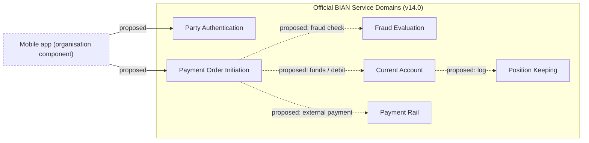

# Example: Banking Requirement → BIAN Mapping

> **Status of this example:** *Illustrative.* The requirement, actors and the "organisation" view are **fictional** and use no real customer data. The BIAN artefact names, Control Records, Behavior Qualifiers, operations and endpoints are **verified against the official BIAN v14.0.0 OpenAPI files** (`bian-official/public` @ commit `b58bf4c2c300dd018afc084e9bb24b7adaaa3500`, folder `release14.0.0/semantic-apis/oas3 /yamls/`, checked 2026-11-05). Items that need the (registration-gated) BIAN Portal are marked **Unverified**. This is the *shape* of the answer the skill should produce, not an official BIAN scenario.
>
> **Release:** BIAN v14.0 · **Evidence labels:** `Official` · `Derived` · `Recommendation` · `Unverified`

## 1. Input requirement (fictional)

> **REQ-101** – "A retail customer shall be able to make a one-off domestic payment from their current account in the mobile app. The bank must authenticate the customer, check funds, run a fraud check, and record the payment in the account."

## 2. Executive summary
- Five Service Domains are strong candidates: **Party Authentication**, **Payment Order Initiation**, **Fraud Evaluation**, **Current Account**, **Position Keeping**; **Payment Rail** is a candidate if the payment leaves the bank.
- Business Area / Business Domain placement and each SD's Functional Pattern could **not** be read from an accessible source (Portal is registration-gated); they are marked `Unverified` or `Derived`.
- Four decisions are open (§8): who records the account position, where funding is confirmed, how the payment leaves the bank, and whether the payment-rail SD applies.

## 3. Requirement interpretation
| Element | Interpretation | Evidence |
|---|---|---|
| Business objective | Let a customer move money out of a current account on request. | Supplied requirement |
| Actors | Retail customer; bank. | Supplied requirement |
| Trigger | Customer submits a payment in a channel. | Supplied requirement |
| Outcome | Payment accepted/initiated and reflected on the account. | Supplied requirement |
| Out of scope (not stated) | Cross-border, recurring, bulk, scheme choice, notifications. | Assumption → confirm with owner |

## 4. BIAN mapping (traceability table)

| Req element | Capability (org language) | Business Area / Domain | Service Domain (v14.0) | Functional Pattern | Control Record (OAS14 tag) | Relevant BQs (OAS14 tags) | Operations (path suffix / method) | Mapping status | Evidence | Confidence |
|---|---|---|---|---|---|---|---|---|---|---|
| Authenticate customer | Customer authentication | Unverified | Party Authentication | Derived: CR is an *Assessment* → pattern *Assess* (GUIDE FP table) | `PartyAuthenticationAssessment` | `Password`, `Biometric`, `Device`, `Behavior`, `Question`, `Document` | `Evaluate` POST (start assessment), `Grant` PUT (obtain token), `Retrieve` GET | ALIGNED | Official (OAS14); FP Derived | High |
| Capture payment instruction | Payment initiation | Unverified | Payment Order Initiation | Unverified (CR is a *Transaction* → candidate *Transact*; confirm in Portal) | `PaymentOrderInitiationTransaction` | `Compliance`, `Confirmation`, `OrderInitiation` | `Initiate` POST, `Update` PUT, `Retrieve` GET; BQ: `OrderInitiation/Exchange` PUT | ALIGNED | Official (OAS14) | High |
| Check funds | Funds confirmation | Unverified | Payment Order Initiation (BQ `Confirmation`) **or** Current Account | – | – | `Confirmation` (POI); `AmountBlock` (CA) | POI `Confirmation/Retrieve` GET; CA `AmountBlock/Initiate` POST | **Open decision** | Official names; assignment is a judgement | Medium |
| Fraud check | Fraud detection | Unverified | Fraud Evaluation | Derived: CR is an *Assessment* → *Assess* | `FraudEvaluationAssessment` | `RuleSetsandDecisionTrees`, `Models` | `Evaluate` POST, `Exchange` PUT, `Execute` PUT, `Grant` PUT, `Retrieve` GET | ALIGNED | Official (OAS14) | Medium–High |
| Record on the account | Account servicing | Unverified | Current Account | Derived: CR is a facility (*Fulfill*) | `CurrentAccountFacility` | `DebitandCredit`, `Payment`, `Booking`, `AmountBlock`, `Charge` | `DebitandCredit/Initiate` POST, `DebitandCredit/{id}/Execute` PUT, `Booking/{id}/Execute` PUT | ALIGNED (needs decision on `Payment` vs `DebitandCredit`) | Official (OAS14) | Medium |
| Post to position log | Transaction log | Unverified | Position Keeping | Derived: CR is a *Log* → *Track* | `FinancialPositionLog` | `FinancialTransactionCapture` | `FinancialTransactionCapture/{id}/Capture` PUT | Candidate | Official (OAS14) | Medium |
| Send payment externally (if applicable) | Payment clearing | Unverified | Payment Rail | Unverified | `PaymentRailOperatingSession` | `OutboundTransaction`, `InboundTransaction`, `PaymentClearingandSettlement` | `OutboundTransaction/Initiate`, `…/Execute`, `…/Notify` | Candidate | Official (OAS14) | Medium |

Notes:
- **Functional Pattern column** is *not* in the OpenAPI files. "Derived" entries come from the generic-artifact table in the Practitioner Guide V8.1 (CR type ↔ pattern). Treat them as `BIAN-derived`, and verify in the Portal before publishing.
- **Business Area/Domain** is `Unverified` for all rows; do not guess.
- v14.0 renamed **Payment Initiation → Payment Order Initiation** and made **Payment Instruction** obsolete (replaced by Payment Order Initiation "in next release"); the mapping uses the current name (RN14 §4.2–4.3).

## 5. Why alternatives were or were not chosen
| Alternative SD | Where the name could mislead | Decision | Reason |
|---|---|---|---|
| Payment Rail | Name contains "Payment" | Candidate only if the payment goes to an external rail | Its CR is a *rail operating session*; its BQs are inbound/outbound transactions and clearing/settlement; description: operational interface with payment service providers. Not the customer-facing capture of the instruction. |
| Position Keeping | "Position/transaction" | Supports recording | Maintains a log of monetary transactions posted to product facilities. Does not authenticate, decide or initiate. |
| Financial Accounting | "Accounting" | Not selected | Concerns general-ledger accounting instructions, not the customer's account activity (CR `FinancialBookingLog`, BQ `LedgerPosting`). Might apply downstream for bank-internal ledger posting; out of the stated scope. |
| Payment Execution / Payment Instruction / Payment Order (older names) | Match the words "payment instruction" | **Rejected: Obsolete in 14.0** | RN14 §4.2: lifecycle changed to Obsolete; Payment Order Initiation named as replacement for Payment Instruction. |
| Customer Access Entitlement | "Customer … access" | Not selected | Maintains allowed channel/device access; authentication itself is Party Authentication. Could be consulted for entitlement checks. |

## 6. Business Objects (from OAS14)
Examples that exist in the Payment Order Initiation spec (do not invent others):
`PaymentOrderInitiationTransaction` (CR payload: includes `PaymentTransaction`, `PayerReference`, `PayerBankReference`, `PayeeReference`, `PayeeBankReference`, `Amount`, `Currency`, `DateType`/`Date`, `PaymentFeesCharges`, `PaymentMechanism`, `PaymentPurpose`), `Compliance`, `Confirmation` (`PaymentTransactionFundingCheckResult`), `OrderInitiation` (`PaymentOrderProcedureInstanceReference`, `PaymentOrderProcedureInstanceStatus`), `Amount` (`AmountValue`, `AmountCurrency`).
The person/account data for payer/payee are **references** into other SDs' objects; define the owning SD for each reference in the design (open decision O-4).

## 7. Semantic API mapping
| SD | Official file stem (v14.0.0) | Operations in file | Endpoints used by REQ-101 (examples) |
|---|---|---|---|
| Party Authentication | `PartyAuthentication` | 19 | `POST /PartyAuthentication/Evaluate`; `PUT /PartyAuthentication/{partyauthenticationid}/Grant` |
| Payment Order Initiation | `PaymentOrderInitiation` | 7 | `POST /PaymentOrderInitiation/Initiate`; `GET /PaymentOrderInitiation/{paymentorderinitiationid}/Confirmation/{confirmationid}/Retrieve`; `PUT …/OrderInitiation/{orderinitiationid}/Exchange` |
| Fraud Evaluation | `FraudEvaluation` | 8 | `POST /FraudEvaluation/Evaluate` |
| Current Account | `CurrentAccount` | 34 | `POST /CurrentAccount/{currentaccountid}/DebitandCredit/Initiate`; `PUT …/DebitandCredit/{debitandcreditid}/Execute` |
| Position Keeping | `PositionKeeping` | 7 | `PUT /PositionKeeping/{positionkeepingid}/FinancialTransactionCapture/{financialtransactioncaptureid}/Capture` |

Evidence: commit-pinned file URLs per registry (`OAS14`). Each operation returns `200/400/401/403/404/429/500`; error body `HTTPError`. **Not specified by BIAN files:** security schemes and request headers.

## 8. Dependencies, assumptions, open questions

*Arrows are proposed design relationships, not BIAN first-order connections (those were not accessible).*

| # | Open item | Why it matters | Owner to decide |
|---|---|---|---|
| O-1 | Confirm Functional Pattern and Business Area/Domain for each SD in the Portal | These are `Unverified` here | Enterprise architect |
| O-2 | Where is funds availability confirmed: POI `Confirmation` BQ or Current Account `AmountBlock`? | Avoids two components owning the same decision (BSE-ARC-03) | Domain owner |
| O-3 | Does the payment leave via Payment Rail, an in-house switch, or another bank? | Determines Payment Rail relevance; PR is new-named in 14.0 | Payments architect |
| O-4 | Which SD owns payer/payee party data referenced in the payment? | CR ownership (BSE-STR-04) | Data owner |
| O-5 | Org rule vs BIAN: action words in paths (BSE-API-09) | Decide BIAN-style paths or adapter | Architecture board |
| O-6 | Sync vs async interactions | BIAN does not prescribe; design decision | Solution architect |

## 9. Sources and BIAN version
BIAN v14.0 (Feb 2026); RN14 §4.2–4.3; `OAS14` @ `b58bf4c`; GUIDE V8.1 Fig. 9/12 for pattern↔artifact derivation. See `references/bian-source-registry.md`.
