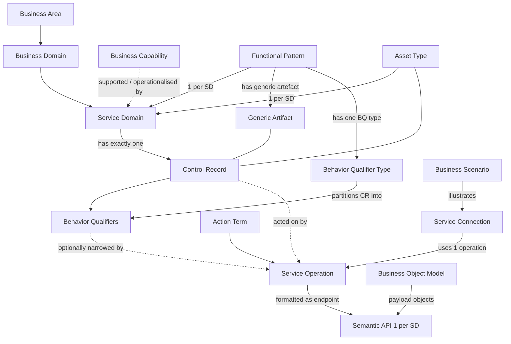

# BIAN Concepts and Metamodel

Concise, paraphrased reference for the BIAN artefacts and how they relate. Not a copy of BIAN documents.

- **Baseline:** BIAN Service Landscape **v14.0** (released Feb 2026). Verified 2026-11-05.
- **Evidence labels used below:** `[Official]` = documented by BIAN in a cited source · `[Derived]` = reasoned from documented relationships · `[Unverified]` = could not be confirmed with accessible sources.
- **Source keys:** `GUIDE` = Semantic API Practitioner Guide **V8.1 (July 2020)** · `RN14` = v14.0 Release Notes v1.0 (20 Feb 2026) · `OAS14` = official v14.0.0 OpenAPI files · full details in [bian-source-registry.md](bian-source-registry.md).
- **Version caution:** `GUIDE` is older than the v14.0 baseline. Where it conflicts with `OAS14` or `RN14`, the newer artefact wins and the conflict is recorded in §12.

## 1. Metamodel at a glance

`[Official]` The BIAN "Figure 8" diagram links Service Domain, Action Terms, Asset Types, Control Record, Behavior Qualifiers, Functional Patterns and Service Operations (GUIDE §3.2.8).

## 2. Business architecture layers

| Concept | Meaning (paraphrased) | Evidence | Source |
|---|---|---|---|
| Service Landscape | Reference structure that organises all Service Domains; different layouts (e.g. matrix, value chain) are possible. | Official | GUIDE §3.1; bian.org Service Landscape page |
| Business Area / Business Domain | Grouping levels above Service Domains used to arrange the landscape. v14.0 reports 38 Business Domains. | Official | GUIDE §3.1; RN14 §1 |
| Business Capability (BCM) | What the bank does, in business terms. v14.0 reports 586 Business Capabilities; the Value Chain / Value Stream restructuring is **work in progress and not yet in the BIAN repository**. | Official | RN14 §1, §3 |
| Service Domain (SD) | A distinct, elemental business responsibility: one Functional Pattern applied to one asset type for the full lifecycle. | Official | GUIDE §2.4, §3.2.1 |
| Business Scenario | Illustrative sequence of Service Domain interactions for one business event. | Official | GUIDE §3.3 |
| Wireframe | Map of available first-order service connections between related Service Domains; a scenario is one journey over it. | Official | GUIDE §3.4 |

### Business Capability vs Service Domain  `[Derived]`
- A **Business Capability** describes *what* the business can do (outcome-oriented, organisation-neutral, hierarchical).
- A **Service Domain** is the *standardised functional partition* that performs a defined behaviour on a defined asset and exposes service operations.
- Capabilities are supported and operationalised by one or more Service Domains; the relation is **many-to-many** and must be confirmed in the BIAN Portal. RN14 states that the descriptions for Business Capabilities, Scenarios, Business Objects and Service Domains were extended in 14.0 and that the capability-to-value-chain restructuring is incomplete, so treat any capability-to-SD mapping that is not read from the Portal as `Unverified`.
- Never treat a Business Domain, Business Area, team, bounded context, microservice or API resource as synonyms of Service Domain (repo rule: `.github/rules/requirement-standards.md`).

## 3. Service Domain

`[Official]` (GUIDE §2.4, §3.2.1, Fig. 19) Key properties:
- Discrete business functional partition, **not a process step**; the peer set covers all banking business activity ("elemental").
- Acts as an operational service centre; may combine people, procedures and systems; can be outsourced as a sizing test.
- Does "something" to "something" for the **full lifecycle**; may handle one or millions of instances, short- or long-lived.
- "Right-sized": a bank either adopts the Service Domain in its entirety or not at all; if a function can be partly adopted it fails the standard's canonical test (GUIDE Att. B).

Per-SD attributes to collect when available (from the Portal): name/identifier, Business Area/Domain, role/executive summary, Functional Pattern, asset type, Control Record, Behavior Qualifiers, Service Operations, Business Objects, first-order connections, lifecycle status (e.g. Registered, Provisional, Obsolete, per RN14 §4.2), release.

Do **not** claim any of those attributes unless read from a cited source. `bian-v14-service-domain-index.md` covers only structural API metadata (see its header for scope).

## 4. Functional Patterns (FP)

`[Official]` GUIDE V8.1 Fig. 8 defines **19** Functional Patterns. Every SD applies exactly one. Each has a **generic artifact** (the noun form of the behaviour) and a **behavior qualifier type** (GUIDE Fig. 9, 12):

| Functional Pattern | Generic Artifact | Behavior Qualifier Type |
|---|---|---|
| Advise | Advice | Topics |
| Fulfill | Arrangement | Features |
| Transact | Transaction | Tasks / Steps |
| Track | Log Record | Events |
| Analyse | Analysis | Algorithms |
| Monitor | State | Measures |
| Operate | Operating Session | Functions |
| Direct | Strategy | Goals |
| Manage | Management Plan | Duties |
| Catalog | Directory Entry | Properties |
| Administer | Administrative Plan | Routines |
| Agree Terms | Agreement | Terms & Conditions |
| Enroll | Membership | Clauses |
| Allocate | Allocation | Criteria |
| Assess | Assessment | Tests |
| Design | Specification | Aspects |
| Develop | Development | Deliverables |
| Maintain | Maintenance Arrangement | Tasks |
| Process | Procedure | Worksteps |

Version notes:
- RN14 §5 spells one pattern **"Agree Term"** where GUIDE V8.1 writes "Agree Terms". Treat as the same pattern; confirm naming in the Portal. `[Unverified]` whether further patterns were added after V8.1: RN14 reports only five FP re-assignments and no new pattern, but the Portal was not accessible.
- RN14 §5: five SDs changed pattern in 14.0: Card Network Participant Facility and Fiduciary Agreement (Fulfill → Agree Term); Consumer Advisory Services, Corporate Tax Advisory and Legal Advisory (Fulfill → Advise).
- **Terminology correction:** words such as *Execute*, *Register*, *Initiate*, *Retrieve*, *Update*, *Control*, *Notify*, *Request*, *Exchange*, *Evaluate*, *Provide* are **Action Terms** (§8), not Functional Patterns. *Manage*, *Maintain*, *Fulfill*, *Agree Terms*, *Assess*, *Advise*, *Design*, *Direct* are Functional Patterns. *Register* is an action term; *Catalog* and *Enroll* are the pattern-level notions for directory/membership behaviour.
- The per-SD Functional Pattern is **not in the OpenAPI files**. Where it is inferred from the Control Record tag (e.g. a CR named "...Assessment" implies generic artifact *Assessment* hence *Assess*), label it `[Derived]` and ask for Portal confirmation.

## 5. Control Record (CR)

`[Official]` (GUIDE §3.2.3, §2.4)
- Every SD has **one** control record: the artefact used to control/trace one occurrence of the SD performing its role over a complete lifecycle.
- CR = generic artifact (from the FP) + asset type. Example: Current Account (FP Fulfill) has CR instances that are fulfilment arrangements; Customer Billing (FP Process) has billing procedures (GUIDE Att. A).
- Contains the main business information governed by the SD: information needed to control processing, referenced information, and information generated during a full cycle. Can be treated as a "class".
- BIAN provides *initial* CR definitions that implementers filter and extend for a project.
- In the v14.0.0 OpenAPI files the CR appears as the tag `CR - <Name>` (e.g. `CR - PaymentOrderInitiationTransaction`).

`[Derived]` The CR is the data the SD **owns/governs**. It is not the entire Business Object Model, and it is not a persistence schema. Do not assume that every BOM attribute belongs in a given CR.

Information Profile `[Official]` (GUIDE §3.2.7): beyond CR instances, an SD's information includes service-centre control/management information, collective views and analyses across CR instances, and the content of individual CR instances broken down by BQs.

## 6. Behavior Qualifiers (BQ)

`[Official]` (GUIDE §3.2.4)
- A BQ narrows a service operation to a sub-partition of the CR so the operation has a single, unambiguous purpose (e.g. "execute" on a current account is ambiguous; "execute | payment" vs "execute | deposit" is not).
- Each FP has one **BQ type** (table in §4). The partitions keep the behavioural character of the parent pattern ("fractal").
- BQs are SD-specific; BIAN defines only the **first level**. Implementers may add sub-qualifiers, which must be MECE at each level and use the same BQ type.
- In v14.0.0 OAS files BQs appear as tag `BQ - <Name>` and as a path segment (`/CurrentAccount/{currentaccountid}/Payment/{paymentid}/Execute`).
- Lifecycle: BQs are renamed, replaced and deleted between releases; consult [bian-release-14-changes.md](bian-release-14-changes.md). Example verified in `OAS14`: the v14.0 renames "Withdrawal → Debit and Credit" and "Account Statement → Financial Status Tracking" appear in Current Account as BQ `DebitandCredit` and schema `FinancialStatusTracking`.
- Distinguish: *generic* operations act on the CR (`/{SD}/{id}/{Action}`), *BQ-specific* operations act on a partition (`/{SD}/{id}/{BQ}/{bqid}/{Action}`).

## 7. Business Object Model (BOM)

`[Official]` (GUIDE §4.2.1, RN14 §1, §8)
- BIAN maintains its own conceptual Business Object Model because the ISO 20022 Business Model has gaps and misalignments; BIAN maps semantic attributes to ISO 20022 where possible.
- Documented in UML class diagrams; v14.0 adds data-type and enumeration diagrams (Account, Payment, Card, Customer, Loan, Securities, Insurance, etc.) and new BOM diagrams (Funeral Policy, Claim Assessment, Claim Administration, Discount Pricing).
- In the BOM-extended OpenAPI files, business objects appear as `components/schemas` objects, enumerations as `enum` schemas, and attribute lists are filtered by the action term.
- Never invent BIAN attribute names, types or enumerations: read them from the SD's `OAS14` file or the Portal and cite the file.

## 8. Service Operations and Action Terms

`[Official]` (GUIDE §3.2.5)
- A **service operation** = action term + Control Record, optionally narrowed by one Behavior Qualifier. Its payload is an organised list of semantic attributes.
- It expresses a **service dependency**; it does not prescribe protocol, choreography, synchronicity or timing.
- GUIDE V8.1 defines **17 action terms** in four groups: service-centre (Activate, Configure, Feedback); create a new CR instance (Create, Initiate, Register, Evaluate, Provide); act on an existing instance (Update, Control, Exchange, Capture, Execute, Request, Grant); read-only (Retrieve, Notify; useful for CQRS).
- Default operation sets exist per FP but are only starting points: not every SD supports every operation, and extra operations may exist.
- The same action term can look different across FPs because SDs have different operating profiles (GUIDE Att. A: *Initiate* on Current Account sets up a facility; on Customer Billing it triggers the end-to-end billing run).

**What `OAS14` shows (observed over all 258 files, 2026-11-05)** `[Official]` structure of the specification files:

| Action term (path suffix) | HTTP method | Ops |
|---|---|---|
| Initiate, Create, Register, Evaluate, Provide, Activate | POST | 490, 58, 46, 88, 5, 1 |
| Retrieve, Notify | GET | 981, 247 |
| Update, Control, Exchange, Execute, Request, Grant, Capture | PUT | 846, 198, 473, 387, 550, 91, 119 |

`Configure` and `Feedback` do not occur as path suffix in the v14.0.0 OAS set (observed, not a statement about the model). GUIDE V8.1 says *Notify* is "not currently used in the BIAN mapping"; v14.0.0 contains 247 `GET .../Notify` operations, so the **newer artefact prevails** (see §12).

Endpoint pattern `[Official]` (observed in `OAS14`; GUIDE Fig. 25 describes the construction):
`/{ServiceDomain}/{cr-reference-id}/{BQ}/{bq-reference-id}/{ActionTerm}` with `Initiate`/`Evaluate`/`Create`/`Register` omitting the instance id. Every operation lists responses `200, 400, 401, 403, 404, 429, 500`; error body `HTTPError{status_code,status,message}`; no `securitySchemes` are defined (security is implementation-defined).

## 9. Semantic APIs

`[Official]` (RN14 §11, GUIDE §3.5, `OAS14`)
- **One API specification per Service Domain**; only SDs with at least one Service Operation get an API. v14.0: 242 published; 16 SDs have none: BrokeredProductProxy, CardTransactionTracking, ClaimAdministration, ClaimAssessment, CustomerSurveys, FuneralPolicy, IncentiveAccount, IncentiveProgramDirectory, IssuedCertificateDirectory, LegalAdvisory, OperationsLog, PartnerAdministration, PartnerManagement, RewardsDelivery, RewardsInventory, RewardsMenu.
- Four flavours: REST + BIAN BOM; REST + ISO 20022 extended (annotated for DDD); Async + BIAN BOM; Async + ISO 20022 extended. Verified repo paths in the source registry.
- Semantic endpoints are **classifications of a business exchange formatted like REST**, "some way from implementation specifications". Implementers must add decomposition for orchestration/errors, physical data detail mapped to host systems or message standards, and operational attributes (headers, security, error handling, indexing). Prefixes/postfixes for versioning and system linkage are expected (GUIDE §3.5).
- GUIDE aligns control-record generic artifacts to REST archetypes (Document, Collection, Controller); it explains the mapping but does not make REST mandatory.

## 10. Business Scenarios and Service Connections

`[Official]` (GUIDE §3.1, §3.2.6, §3.3, §3.4)
- Scenarios and wireframes are usage examples; **technically not part of the formal BIAN standard** and **not prescriptive**.
- Scenario properties: bounded, meaningful, **non-prescriptive**, **loosely coupled**, **non-exhaustive**, non-redundant.
- A **first-order connection** is one dependency between one calling and one called SD using one service operation (action term + optional BQ). Known connections are discovered empirically and are not guaranteed complete.
- A connection may be associated with a first-order business event that triggers the call.
- v14.0 adds Payment scenarios: External Credit Transfer; External Direct Debit; Request to Pay (bank as RTP SP); Card Payment (SMS) as RTP; Credit Transfer from Issuer to Merchant Account (RN14 §9). Scenario content itself was not accessible; use only the names.

## 11. Events and ISO 20022

- `[Official]` GUIDE §3.6 labels **Service Domain Event Triggering a proposed design extension** (not a standard artefact in V8.1). It describes event-driven orchestration, state-transition events, referential dependencies, idempotent/commutative exchanges and defensive operations as design properties.
- `[Official]` v14.0.0 publishes **AsyncAPI 3.x** specifications per SD (e.g. channels `CurrentAccountFacility/Created`, `CurrentAccountFacility/Updated`, `AmountBlock/Created`). Consult the file for the channels and payloads of a specific SD.
- `[Official]` BIAN's stated policy is not to compete with other industry standards; it maps its semantic attributes to the ISO 20022 Business Model where possible and maintains its own BOM where ISO has gaps (GUIDE §3.2.7/§4.2.1). The ISO-extended OAS files carry ISO 20022 repository references in attribute descriptions (observed in `CurrentAccount` ISO flavour).
- `[Derived]` Event names and ISO 20022 message selection (e.g. which `pacs`/`pain` message to use) are **not** specified by the sources reviewed. Any such mapping must be labelled *proposed integration mapping*, not official.

## 12. Known cross-source conflicts

| Topic | Older statement | Newer statement | Resolution |
|---|---|---|---|
| Notify in REST mapping | GUIDE V8.1: "Notify is not currently used in the BIAN mapping". | `OAS14` contains 247 `GET .../Notify` operations. | Prefer `OAS14` for v14 work. |
| Number of Semantic APIs | GUIDE V8.1: "over 140 Service Domains". | RN14: 242 APIs. | Prefer RN14. |
| Number of SDs | GUIDE V8.1: "320+". | RN14/Landscape: 322 (v14.0). | Consistent. |
| "Agree Terms" spelling | GUIDE V8.1 | RN14 "Agree Term" | Same pattern; confirm in Portal. |
| Operation payload format | Pre-V8 releases used four attribute types (Identifiers, Depiction, Instructors, Analysis) | GUIDE V8.1/`OAS14` use semantic attribute lists | Use the current form. |
| REST path style | GUIDE V8.1 Fig. 24 examples use lower-case hyphenated sample URIs; Fig. 25 shows generic assembly | `OAS14` uses PascalCase `/{SD}/{id}/{BQ}/{id}/{Action}` | `OAS14` is authoritative for v14. |
| Action word in path | Repo rule `.github/rules/architectural-standards.md`: "do not mechanically place action words in REST resource paths" | `OAS14` places the action term as the final path segment | Org policy vs BIAN spec: surface for human decision; see rule `BSE-API-09`. |
